# Get your inputs

You need two things before you open the app: a file from SMART, and access to the EarthRanger site the data is going to.

## From SMART: a backup or an export

You need one file, not all three. The app accepts any one of these, as a single `.zip` file:

- **A Conservation Area export.** It holds one conservation area. SMART names it `SMART_<area identifier>_<date>.bak.zip`.
- **A SMART system backup.** SMART names it `SMART_<date>.bak.zip`. It holds every conservation area in that copy of SMART; you choose which to load later.
- **A zipped SMART Desktop folder.** Zip the whole folder SMART Desktop runs from. Use this when you cannot run SMART to make an export or a backup.

Upload the `.zip` as it is. Do not unzip it, and do not upload a file from inside it.

The person who runs SMART at the site is usually the one to make the file. A backup holds ranger names and patrol locations, so ask them to send it by a private channel, not a public link.

Choose the one you will make, and follow its steps. The steps and pictures for the export and the backup are from SMART Desktop 7.5.6 on Windows. Other versions may differ.

### Conservation Area export {: .tab }

1. Open SMART Desktop. On the sign-in screen, choose the conservation area, enter the username and password of an administrator of that area, and select **Login**.

    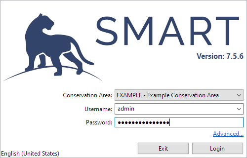

2. Choose **File → Export Conservation Area...**. It is the first item in the File menu.

    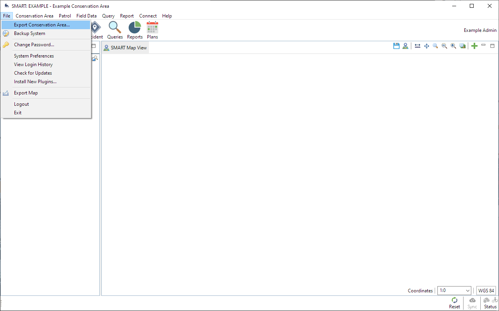

3. In the **Export Conservation Area** window, check the **File** box. It says where the export will be saved and what it will be called. SMART suggests a folder named `backup` inside its own folder; select **Browse...** to save somewhere else. Then select **Export**.

    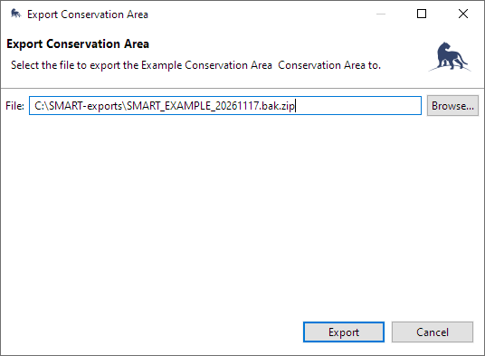

4. Wait for the message "Conservation Area exported successfully." and select **OK**. A small area takes a few seconds; an area with years of patrols takes longer.

    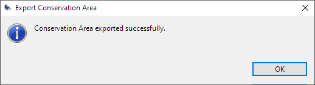

5. Find the file in the folder you chose. Its name ends in `.bak.zip`, and Windows lists it as a compressed (zipped) folder. This is the file to upload.

    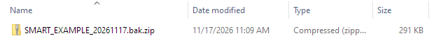

### System backup {: .tab }

1. Open SMART Desktop. On the sign-in screen, choose any conservation area, enter the username and password of an administrator of that area, and select **Login**.
2. Choose **File → Backup System**.

    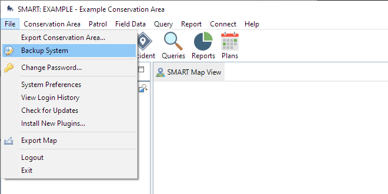

3. In the **Backup SMART System** window, check the **File** box, or select **Browse...** to save somewhere else. Leave **Exclude filestore from backup** unticked: the filestore holds the photos attached to patrols, and a backup without it loads without them. Then select **Backup**.

    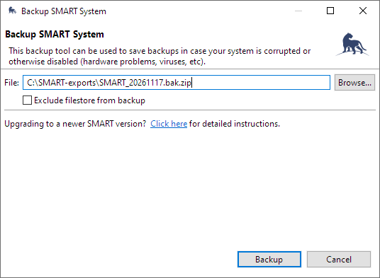

4. Wait for the **Backup Complete** message, which names the file, and select **OK**.

    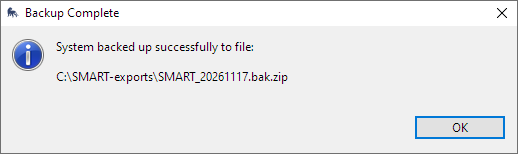

5. Find the file in the folder you chose. It is named `SMART_<date>.bak.zip`, with the date as year, month and day.

    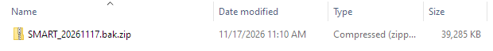

A backup with photos can be large, because it holds the photos of every conservation area.

### Zipped SMART folder {: .tab }

1. Close SMART Desktop if it is open.
2. In File Explorer, find the folder SMART Desktop runs from. It is the folder that holds `SMART.exe` and a folder named `data`. SMART has no fixed place on the disk: it runs from wherever its folder was put when it was set up.

    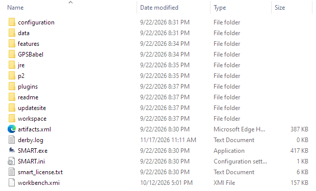

3. Go up one level, right-click that folder, and choose **Send to → Compressed (zipped) folder**. On Windows 11, choose **Compress to ZIP file**.

    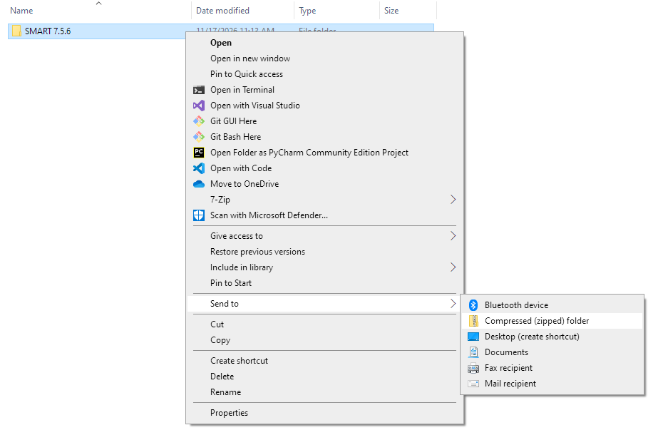

4. Windows writes a `.zip` beside the folder. This can take several minutes and several gigabytes of free disk space.

## From EarthRanger: the site and a token

The app writes to EarthRanger as one EarthRanger user, through that user's API token. You need:

- **The site's host**, such as `example.pamdas.org`. Give the host only, without `https://` or a path.
- **An API token** for a user on that site. Ask the site's EarthRanger administrator for one.

The user behind the token must be able to manage patrol types, subjects, subject groups, patrol configuration and the patrol fields, and to create events. A superuser is the simple choice. With a narrower user, the load tells you each permission that is missing.

The app checks the token against the site before it saves it, and shows only its last characters afterwards. [Sites and tokens](../help/02-sites.md) says where the token is kept and who can use it.

It is worth loading into a test or staging site first, if the customer has one.

## Next

With the file and the token in hand: [Your first migration](03-your-first-migration.md).
