# Reúna lo necesario

Necesita dos cosas antes de abrir la aplicación: un archivo de SMART y acceso al sitio de EarthRanger al que irán los datos.

## De SMART: una copia de seguridad o una exportación

Necesita un solo archivo, no los tres. La aplicación acepta cualquiera de estos, como un único archivo `.zip`:

- **Una exportación de Área de Conservación.** Contiene una sola área de conservación. SMART la llama `SMART_<area identifier>_<date>.bak.zip` (identificador del área y fecha).
- **Una copia de seguridad del sistema SMART.** SMART la llama `SMART_<date>.bak.zip`. Contiene todas las áreas de conservación de esa copia de SMART; más adelante usted elige cuál cargar.
- **Una carpeta de SMART Desktop comprimida.** Comprima en zip toda la carpeta desde la que se ejecuta SMART Desktop, con SMART Desktop cerrado. Use esta opción cuando no pueda ejecutar SMART para hacer una exportación o una copia de seguridad.

Suba el `.zip` tal como está. No lo descomprima, y no suba un archivo de su interior.

Lo habitual es que el archivo lo genere la persona que maneja SMART en el sitio. Una copia de seguridad contiene nombres de guardaparques y ubicaciones de patrullas, así que pídale que lo envíe por un canal privado, no con un enlace público.

Elija el que va a generar y siga sus pasos. Los pasos y las imágenes de la exportación y de la copia de seguridad son de SMART Desktop 7.5.6 en Windows. Otras versiones pueden ser distintas. Las imágenes muestran SMART en inglés; cada paso da el nombre tal como SMART lo muestra en español, seguido del nombre en inglés entre paréntesis.

### Exportación de Área de Conservación {: .tab }

1. Abra SMART Desktop. En la pantalla de inicio de sesión, elija el área de conservación, escriba el nombre de usuario y la contraseña de un administrador de esa área y seleccione **Iniciar sesión** (Login).

    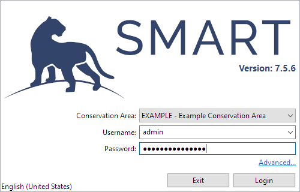

2. Elija **Archivo → Exportar Área de Conservación ...** (File → Export Conservation Area...). Es el primer elemento del menú Archivo.

    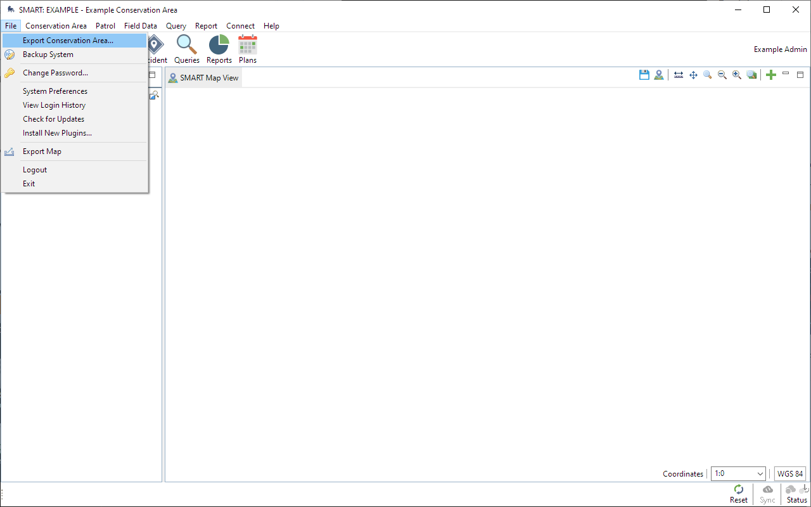

3. En la ventana **Exportar Área de Conservación** (Export Conservation Area), revise el cuadro **Archivo** (File). Indica dónde se guardará la exportación y cómo se llamará. SMART propone una carpeta llamada `backup` dentro de su propia carpeta; seleccione **Buscar...** (Browse...) para guardar en otro lugar. Después seleccione **Exportar** (Export).

    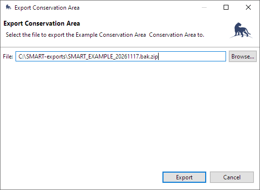

4. Espere el mensaje «Área de Conservación exportada exitosamente» (Conservation Area exported successfully.) y seleccione **OK**. Un área pequeña tarda unos segundos; un área con años de patrullas tarda más.

    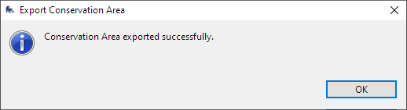

5. Busque el archivo en la carpeta que eligió. Su nombre termina en `.bak.zip`, y Windows lo muestra como una carpeta comprimida. Este es el archivo que debe subir.

    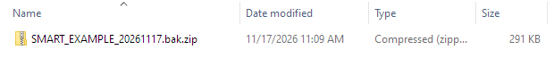

### Copia de seguridad del sistema {: .tab }

1. Abra SMART Desktop. En la pantalla de inicio de sesión, elija cualquier área de conservación, escriba el nombre de usuario y la contraseña de un administrador de esa área y seleccione **Iniciar sesión** (Login).
2. Elija **Archivo → Sistema de copia de seguridad** (File → Backup System).

    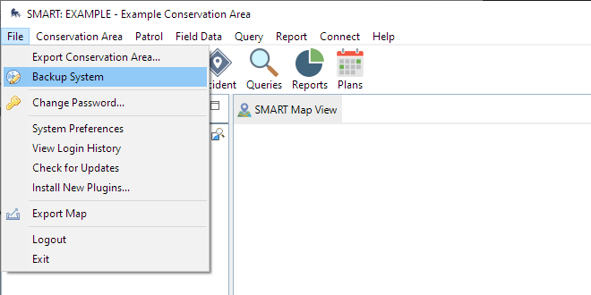

3. En la ventana **Sistema de copia de seguridad de SMART** (Backup SMART System), revise el cuadro **Archivo** (File), o seleccione **Buscar...** (Browse...) para guardar en otro lugar. Deje sin marcar **Excluir archivos en la copia de seguridad** (Exclude filestore from backup): el almacén de archivos contiene las fotos adjuntas a las patrullas, y una copia de seguridad sin él se carga sin ellas. Después seleccione **Copia de seguridad** (Backup).

    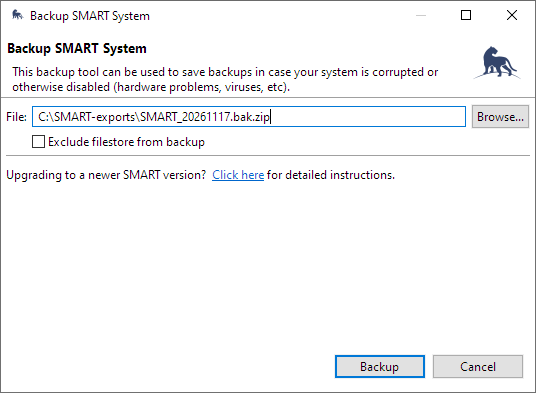

4. Espere el mensaje **Copia de seguridad completa** (Backup Complete), que nombra el archivo, y seleccione **OK**.

    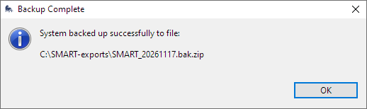

5. Busque el archivo en la carpeta que eligió. Se llama `SMART_<date>.bak.zip`, con la fecha como año, mes y día.

    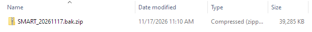

Una copia de seguridad con fotos puede ser grande, porque contiene las fotos de todas las áreas de conservación.

### Carpeta de SMART comprimida {: .tab }

**SMART Desktop debe estar cerrado antes de comprimir su carpeta.** Mientras SMART está abierto sigue escribiendo en su base de datos, y un zip hecho en ese momento puede contener una base de datos que no se puede leer.
{: .important }

1. Cierre SMART Desktop: elija **Archivo → Salir** (File → Exit) y espere a que su ventana desaparezca.
2. En el Explorador de archivos, busque la carpeta desde la que se ejecuta SMART Desktop. Es la carpeta que contiene `SMART.exe` y una carpeta llamada `data`. SMART no tiene un lugar fijo en el disco: se ejecuta desde donde se colocó su carpeta al instalarlo.

    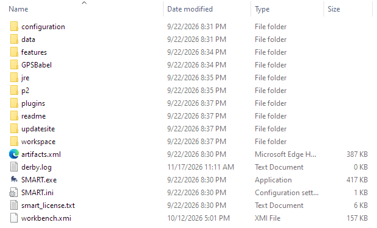

3. Vaya un nivel hacia arriba, haga clic con el botón derecho en esa carpeta y elija **Enviar a → Carpeta comprimida (en zip)** (Send to → Compressed (zipped) folder). En Windows 11, elija **Comprimir en archivo ZIP** (Compress to ZIP file).

    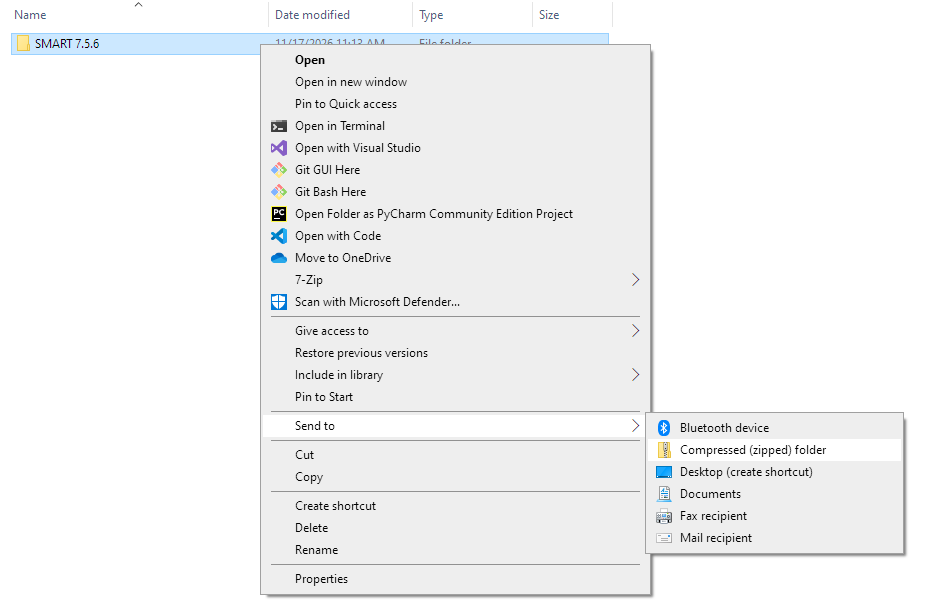

4. Windows escribe un `.zip` junto a la carpeta. Esto puede tardar varios minutos y ocupar varios gigabytes de espacio libre en el disco. Mantenga SMART Desktop cerrado hasta que termine.

## De EarthRanger: el sitio y un token

La aplicación escribe en EarthRanger como un usuario de EarthRanger, mediante el token de API de ese usuario. Necesita:

- **El host del sitio**, por ejemplo `example.pamdas.org`. Dé solo el host, sin `https://` ni ruta.
- **Un token de API** de un usuario de ese sitio. Pídaselo al administrador de EarthRanger del sitio.

El usuario al que pertenece el token debe poder gestionar los tipos de patrullaje, los sujetos, los grupos de sujetos, la configuración de patrullas y los campos de patrulla, y crear eventos. Un superusuario es la opción sencilla. Con un usuario más limitado, la carga le indica cada permiso que falta.

La aplicación comprueba el token con el sitio antes de guardarlo, y después solo muestra sus últimos caracteres. [Sitios y tokens](../../help/es/02-sites.md) explica dónde se guarda el token y quién puede usarlo.

Vale la pena cargar primero en un sitio de pruebas o de preproducción, si el cliente tiene uno.

## Siguiente

Con el archivo y el token en mano: [Su primera migración](03-your-first-migration.md).
