# Réunir vos éléments

Il vous faut deux choses avant d'ouvrir l'application : un fichier provenant de SMART, et un accès au site EarthRanger où iront les données.

## De SMART : une sauvegarde ou un export

Il vous faut un seul fichier, pas les trois. L'application accepte n'importe lequel de ceux-ci, sous la forme d'un seul fichier `.zip` :

- **Un export de zone de conservation.** Il contient une seule zone de conservation. SMART le nomme `SMART_<area identifier>_<date>.bak.zip` (identifiant de la zone, puis date).
- **Une sauvegarde du système SMART.** SMART la nomme `SMART_<date>.bak.zip`. Elle contient toutes les zones de conservation de cette copie de SMART ; vous choisirez plus tard laquelle charger.
- **Un dossier SMART Desktop compressé.** Compressez en zip tout le dossier à partir duquel SMART Desktop s'exécute, SMART Desktop étant fermé. Utilisez cette solution lorsque vous ne pouvez pas lancer SMART pour faire un export ou une sauvegarde.

Téléversez le `.zip` tel quel. Ne le décompressez pas, et ne téléversez pas un fichier qui se trouve à l'intérieur.

C'est en général la personne qui utilise SMART sur le site qui produit le fichier. Une sauvegarde contient les noms des écogardes et les lieux des patrouilles : demandez-lui donc de l'envoyer par un canal privé, et non par un lien public.

Choisissez celui que vous allez produire et suivez ses étapes. Les étapes et les images de l'export et de la sauvegarde viennent de SMART Desktop 7.5.6 sous Windows. Les autres versions peuvent différer. Les images montrent SMART en anglais ; chaque étape donne le nom tel que SMART l'affiche en français, suivi du nom anglais entre parenthèses.

### Export de zone de conservation {: .tab }

1. Ouvrez SMART Desktop. Sur l'écran de connexion, choisissez la zone de conservation, saisissez le nom d'utilisateur et le mot de passe d'un administrateur de cette zone, puis sélectionnez **Connexion** (Login).

    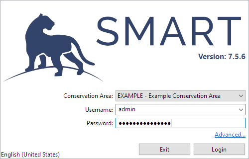

2. Choisissez **Fichier → Exporter la zone de conservation ...** (File → Export Conservation Area...). C'est le premier élément du menu Fichier.

    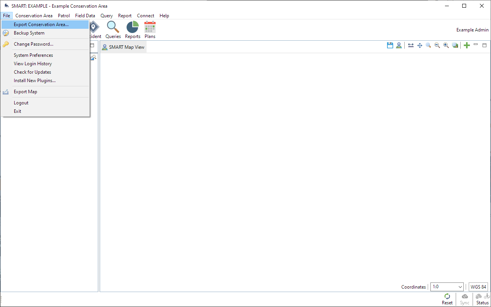

3. Dans la fenêtre **Exporter la zone de conservation** (Export Conservation Area), vérifiez le champ **Fichier** (File). Il indique où l'export sera enregistré et comment il s'appellera. SMART propose un dossier nommé `backup` dans son propre dossier ; sélectionnez **Parcourir...** (Browse...) pour enregistrer ailleurs. Sélectionnez ensuite **Exporter** (Export).

    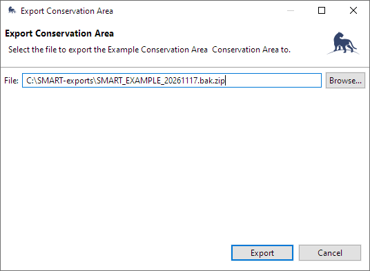

4. Attendez le message « La zone de conservation a été exportée avec succès. » (Conservation Area exported successfully.) et sélectionnez **OK**. Une petite zone prend quelques secondes ; une zone avec des années de patrouilles prend plus longtemps.

    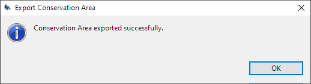

5. Retrouvez le fichier dans le dossier que vous avez choisi. Son nom se termine par `.bak.zip`, et Windows l'affiche comme un dossier compressé. C'est le fichier à téléverser.

    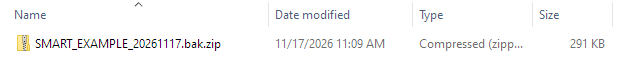

### Sauvegarde du système {: .tab }

1. Ouvrez SMART Desktop. Sur l'écran de connexion, choisissez n'importe quelle zone de conservation, saisissez le nom d'utilisateur et le mot de passe d'un administrateur de cette zone, puis sélectionnez **Connexion** (Login).
2. Choisissez **Fichier → Sauvegarder le système** (File → Backup System).

    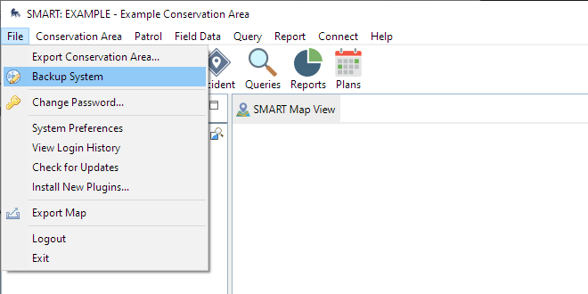

3. Dans la fenêtre **Système de sauvegarde SMART** (Backup SMART System), vérifiez le champ **Fichier** (File), ou sélectionnez **Parcourir...** (Browse...) pour enregistrer ailleurs. Laissez la case **Exclure le stockage de fichiers de la sauvegarde** (Exclude filestore from backup) décochée : le stockage de fichiers contient les photos jointes aux patrouilles, et une sauvegarde qui ne l'inclut pas se charge sans elles. Sélectionnez ensuite **Sauvegarde** (Backup).

    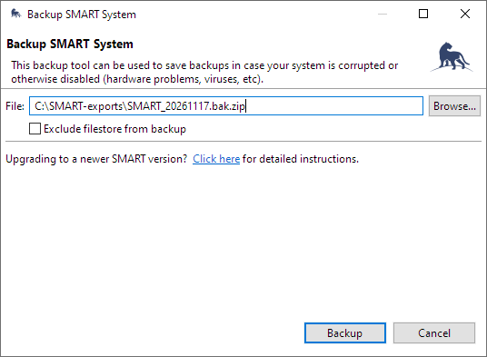

4. Attendez le message **Sauvegarde terminée.** (Backup Complete), qui nomme le fichier, et sélectionnez **OK**.

    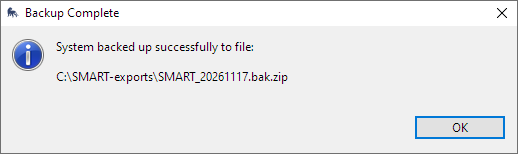

5. Retrouvez le fichier dans le dossier que vous avez choisi. Il est nommé `SMART_<date>.bak.zip`, la date étant écrite année, mois, jour.

    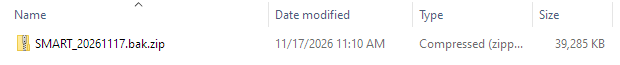

Une sauvegarde avec photos peut être volumineuse, car elle contient les photos de toutes les zones de conservation.

### Dossier SMART compressé {: .tab }

**SMART Desktop doit être fermé avant de compresser son dossier.** Tant que SMART est ouvert, il écrit encore dans sa base de données, et un zip fait à ce moment-là peut contenir une base de données illisible.
{: .important }

1. Fermez SMART Desktop : choisissez **Fichier → Quitter** (File → Exit), et attendez que sa fenêtre disparaisse.
2. Dans l'Explorateur de fichiers, trouvez le dossier à partir duquel SMART Desktop s'exécute. C'est le dossier qui contient `SMART.exe` et un dossier nommé `data`. SMART n'a pas d'emplacement fixe sur le disque : il s'exécute là où son dossier a été placé lors de l'installation.

    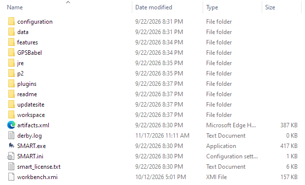

3. Remontez d'un niveau, cliquez avec le bouton droit sur ce dossier et choisissez **Envoyer vers → Dossier compressé** (Send to → Compressed (zipped) folder). Sous Windows 11, choisissez **Compresser dans un fichier ZIP** (Compress to ZIP file).

    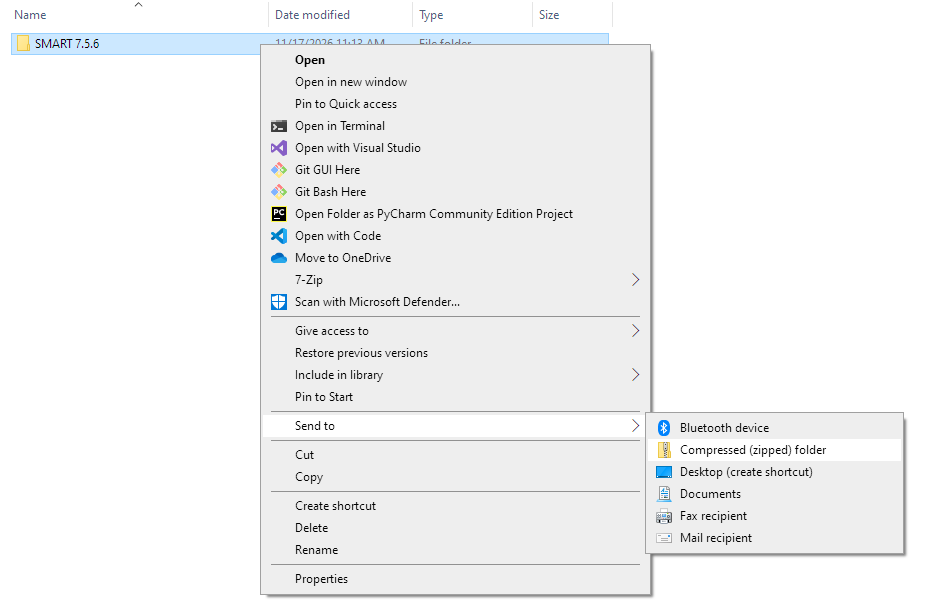

4. Windows écrit un fichier `.zip` à côté du dossier. Cela peut prendre plusieurs minutes et plusieurs gigaoctets d'espace disque libre. Gardez SMART Desktop fermé jusqu'à ce que ce soit terminé.

## D'EarthRanger : le site et un jeton

L'application écrit dans EarthRanger en tant qu'un utilisateur EarthRanger, au moyen du jeton d'API de cet utilisateur. Il vous faut :

- **L'adresse du site**, par exemple `example.pamdas.org`. Vous pouvez la coller telle que le navigateur l'affiche ; l'application ne garde que l'hôte.
- **Un jeton d'API** pour un utilisateur de ce site. Demandez-en un à l'administrateur EarthRanger du site.

L'utilisateur auquel appartient le jeton doit pouvoir gérer les types de patrouille, les sujets, les groupes de sujets, la configuration des patrouilles et les champs de patrouille, et créer des événements. Un superutilisateur est le choix le plus simple. Avec un utilisateur plus restreint, le chargement vous indique chaque autorisation manquante.

L'application vérifie le jeton auprès du site avant de l'enregistrer, et n'en affiche ensuite que les derniers caractères. [Sites et jetons](../../help/fr/02-sites.md) indique où le jeton est conservé et qui peut l'utiliser.

Il vaut la peine de charger d'abord dans un site de test ou de préproduction, si le client en a un.

## Suite

Une fois le fichier et le jeton en main : [Votre première migration](03-your-first-migration.md).
