# Reúna o que é necessário

Você precisa de duas coisas antes de abrir o aplicativo: um arquivo do SMART e acesso ao site do EarthRanger para onde os dados vão.

## Do SMART: um backup ou uma exportação

Você precisa de um arquivo só, não dos três. O aplicativo aceita qualquer um destes, como um único arquivo `.zip`:

- **Uma exportação de Área de Conservação.** Ela contém uma única área de conservação. O SMART a nomeia `SMART_<area identifier>_<date>.bak.zip` (identificador da área e data).
- **Um backup do sistema SMART.** O SMART o nomeia `SMART_<date>.bak.zip`. Ele contém todas as áreas de conservação daquela cópia do SMART; mais tarde você escolhe qual carregar.
- **Uma pasta do SMART Desktop compactada.** Compacte em zip a pasta inteira a partir da qual o SMART Desktop é executado, com o SMART Desktop fechado. Use esta opção quando não puder executar o SMART para fazer uma exportação ou um backup.

Envie o `.zip` como ele está. Não o descompacte, e não envie um arquivo de dentro dele.

Normalmente quem gera o arquivo é a pessoa que opera o SMART no local. Um backup contém nomes de guarda-parques e locais de patrulhas, então peça que ela o envie por um canal privado, não por um link público.

Escolha o que você vai gerar e siga os passos dele. Os passos e as imagens da exportação e do backup são do SMART Desktop 7.5.6 no Windows. Outras versões podem ser diferentes. As imagens mostram o SMART em inglês; cada passo dá o nome como o SMART o exibe em português, seguido do nome em inglês entre parênteses.

### Exportação de Área de Conservação {: .tab }

1. Abra o SMART Desktop. Na tela de entrada, escolha a área de conservação, digite o nome de usuário e a senha de um administrador dessa área e selecione **Login**.

    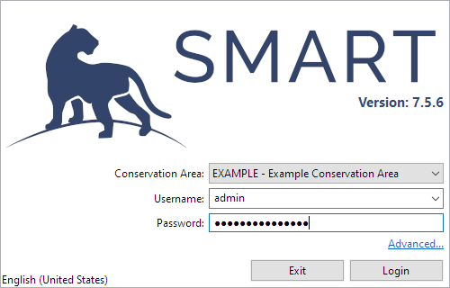

2. Escolha **Arquivo → Exportar Área de Conservação...** (File → Export Conservation Area...). É o primeiro item do menu Arquivo.

    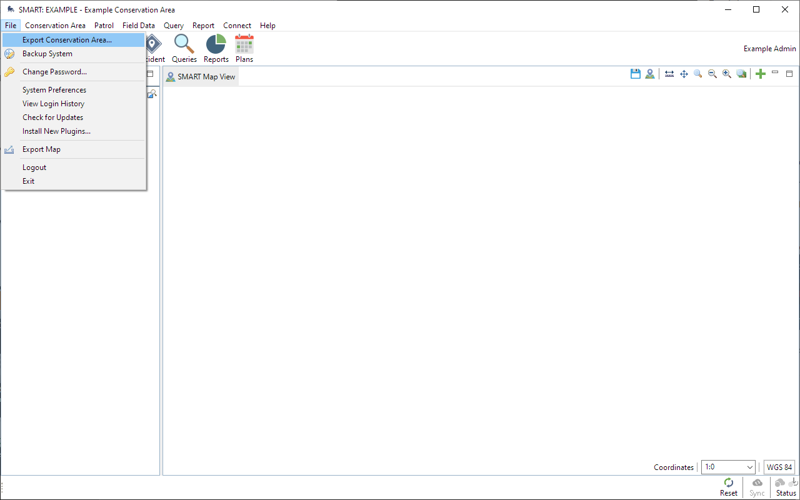

3. Na janela **Exportar Área de Conservação** (Export Conservation Area), confira a caixa **Arquivo** (File). Ela diz onde a exportação será salva e como ela vai se chamar. O SMART sugere uma pasta chamada `backup` dentro da sua própria pasta; selecione **Navegar...** (Browse...) para salvar em outro lugar. Depois selecione **Exportar** (Export).

    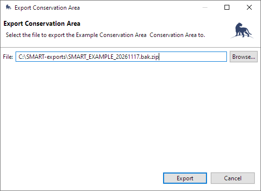

4. Aguarde a mensagem "Área de conservação exportada com sucesso." (Conservation Area exported successfully.) e selecione **OK**. Uma área pequena leva alguns segundos; uma área com anos de patrulhas leva mais tempo.

    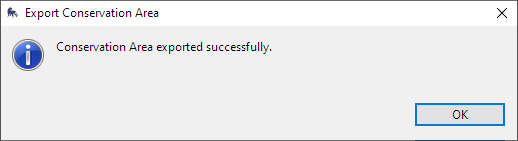

5. Encontre o arquivo na pasta que você escolheu. O nome dele termina em `.bak.zip`, e o Windows o lista como uma pasta compactada. Este é o arquivo a enviar.

    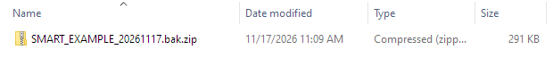

### Backup do sistema {: .tab }

1. Abra o SMART Desktop. Na tela de entrada, escolha qualquer área de conservação, digite o nome de usuário e a senha de um administrador dessa área e selecione **Login**.
2. Escolha **Arquivo → Sistema de Backup** (File → Backup System).

    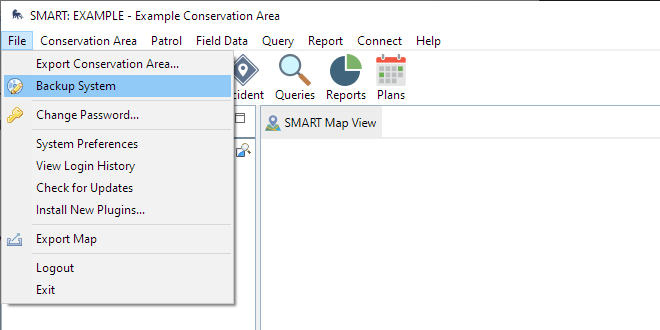

3. Na janela **Sistema de Backup SMART** (Backup SMART System), confira a caixa **Arquivo** (File), ou selecione **Navegar...** (Browse...) para salvar em outro lugar. Deixe **Exclui filestore do backup** (Exclude filestore from backup) desmarcado: o filestore contém as fotos anexadas às patrulhas, e um backup sem ele é carregado sem elas. Depois selecione **Backup**.

    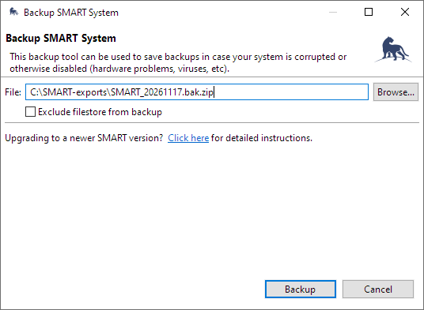

4. Aguarde a mensagem **Backup Concluído** (Backup Complete), que informa o nome do arquivo, e selecione **OK**.

    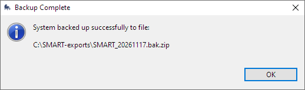

5. Encontre o arquivo na pasta que você escolheu. Ele se chama `SMART_<date>.bak.zip`, com a data como ano, mês e dia.

    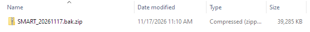

Um backup com fotos pode ser grande, porque contém as fotos de todas as áreas de conservação.

### Pasta do SMART compactada {: .tab }

**O SMART Desktop precisa estar fechado antes de você compactar a pasta dele.** Enquanto o SMART está aberto, ele continua gravando no banco de dados, e um zip feito nesse momento pode conter um banco de dados que não pode ser lido.
{: .important }

1. Feche o SMART Desktop: escolha **Arquivo → Sair** (File → Exit) e espere a janela dele sumir.
2. No Explorador de Arquivos, encontre a pasta a partir da qual o SMART Desktop é executado. É a pasta que contém `SMART.exe` e uma pasta chamada `data`. O SMART não tem um lugar fixo no disco: ele é executado de onde a pasta dele foi colocada na instalação.

    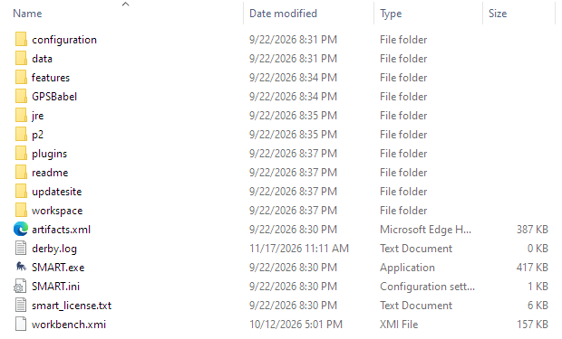

3. Suba um nível, clique com o botão direito nessa pasta e escolha **Enviar para → Pasta compactada** (Send to → Compressed (zipped) folder). No Windows 11, escolha **Compactar para arquivo ZIP** (Compress to ZIP file).

    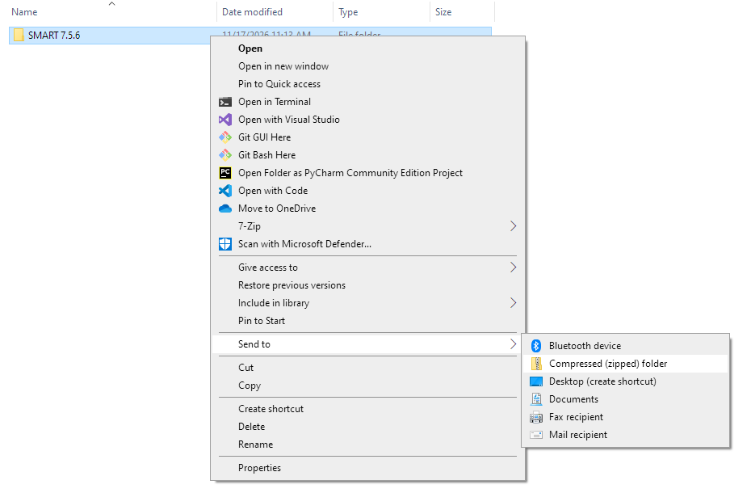

4. O Windows grava um `.zip` ao lado da pasta. Isso pode levar vários minutos e ocupar vários gigabytes de espaço livre no disco. Mantenha o SMART Desktop fechado até terminar.

## Do EarthRanger: o site e um token

O aplicativo grava no EarthRanger como um usuário do EarthRanger, por meio do token de API desse usuário. Você precisa de:

- **O endereço do site**, por exemplo `example.pamdas.org`. Você pode colá-lo como o navegador o mostra; o aplicativo mantém só o host.
- **Um token de API** de um usuário desse site. Peça um ao administrador do EarthRanger do site.

O usuário dono do token precisa poder gerenciar os tipos de patrulha, os sujeitos, os grupos de sujeitos, a configuração de patrulhas e os campos de patrulha, e criar eventos. Um superusuário é a escolha simples. Com um usuário mais restrito, a carga informa cada permissão que falta.

O aplicativo confere o token com o site antes de salvá-lo, e depois mostra só os últimos caracteres dele. [Sites e tokens](../../help/pt/02-sites.md) diz onde o token fica guardado e quem pode usá-lo.

Vale a pena carregar primeiro em um site de teste ou de homologação, se o cliente tiver um.

## Em seguida

Com o arquivo e o token em mãos: [Sua primeira migração](03-your-first-migration.md).
