# Kusanya mahitaji yako

Unahitaji vitu viwili kabla ya kufungua programu: faili kutoka SMART, na ufikiaji wa tovuti ya EarthRanger ambako data zinakwenda.

## Kutoka SMART: chelezo au faili iliyohamishwa

Unahitaji faili moja tu, si zote tatu. Programu inakubali mojawapo ya hizi, kama faili moja ya `.zip`:

- **Eneo la hifadhi lililohamishwa (export).** Lina eneo moja la hifadhi. SMART inaliita `SMART_<area identifier>_<date>.bak.zip` (kitambulisho cha eneo, kisha tarehe).
- **Chelezo ya mfumo wa SMART.** SMART inaiita `SMART_<date>.bak.zip`. Ina kila eneo la hifadhi lililomo kwenye nakala hiyo ya SMART; utachagua baadaye lipi la kuingiza.
- **Folda ya SMART Desktop iliyobanwa (zip).** Bana folda nzima ambayo SMART Desktop inaendeshwa kutoka kwake, SMART Desktop ikiwa imefungwa. Tumia njia hii usipoweza kuendesha SMART ili kuhamisha eneo au kutengeneza chelezo.

Pakia `.zip` jinsi ilivyo. Usiibanue (unzip), na usipakie faili iliyo ndani yake.

Kwa kawaida mtu anayeendesha SMART kwenye eneo ndiye anayetengeneza faili. Chelezo ina majina ya askari na maeneo ya doria, kwa hiyo mwombe aitume kwa njia ya faragha, si kwa kiungo cha wazi.

Chagua utakayotengeneza, kisha fuata hatua zake. Hatua na picha za kuhamisha eneo na za chelezo zinatoka SMART Desktop 7.5.6 kwenye Windows. Matoleo mengine yanaweza kutofautiana. Picha zinaonyesha SMART kwa Kiingereza; kila hatua inataja jina jinsi SMART inavyolionyesha kwa Kiswahili, likifuatiwa na jina la Kiingereza kwenye mabano.

### Kuhamisha eneo la hifadhi {: .tab }

1. Fungua SMART Desktop. Kwenye skrini ya kuingia, chagua eneo la hifadhi, andika jina la mtumiaji na nywila ya msimamizi wa eneo hilo, kisha chagua **Ingia** (Login).

    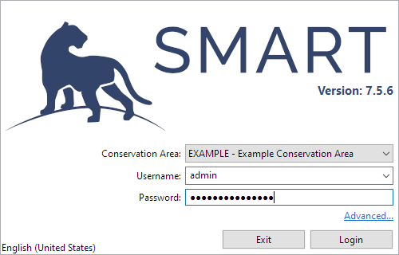

2. Chagua **Faili → Hamisha eneo la uhifadhi...** (File → Export Conservation Area...). Ni kipengele cha kwanza kwenye menyu ya Faili.

    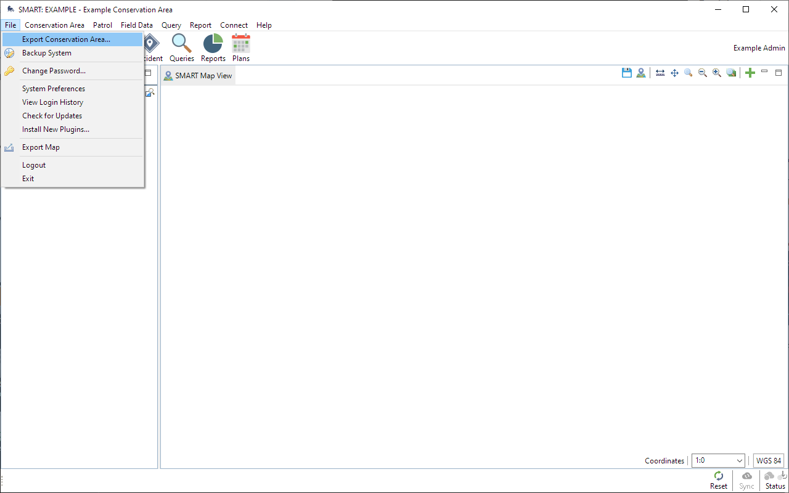

3. Kwenye dirisha la **Hamisha eneo la uhifadhi** (Export Conservation Area), angalia kisanduku cha **Faili** (File). Kinaonyesha mahali faili itakapohifadhiwa na jina lake. SMART inapendekeza folda iitwayo `backup` ndani ya folda yake yenyewe; chagua **Vinjari...** (Browse...) ili kuhifadhi mahali pengine. Kisha chagua **Hamisha** (Export).

    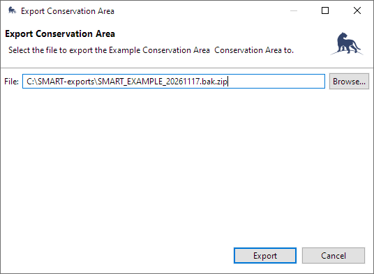

4. Subiri ujumbe "Eneo la uhifadhi limehamishwa kikamilifu." (Conservation Area exported successfully.) kisha chagua **OK**. Eneo dogo linachukua sekunde chache; eneo lenye doria za miaka mingi linachukua muda zaidi.

    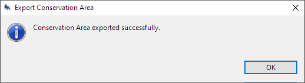

5. Tafuta faili kwenye folda uliyochagua. Jina lake linaishia na `.bak.zip`, na Windows inaionyesha kama folda iliyobanwa. Hii ndiyo faili ya kupakia.

    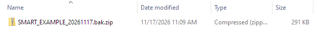

### Chelezo ya mfumo {: .tab }

1. Fungua SMART Desktop. Kwenye skrini ya kuingia, chagua eneo lolote la hifadhi, andika jina la mtumiaji na nywila ya msimamizi wa eneo hilo, kisha chagua **Ingia** (Login).
2. Chagua **Faili → Mfumo chelezo** (File → Backup System).

    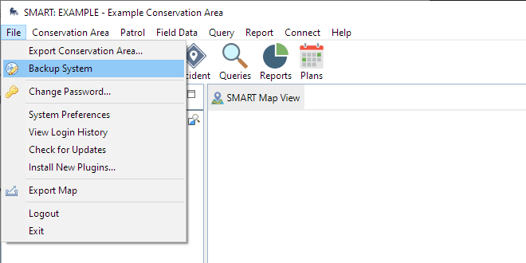

3. Kwenye dirisha la **Mfumo wa chelezo wa SMART** (Backup SMART System), angalia kisanduku cha **Faili** (File), au chagua **Vinjari...** (Browse...) ili kuhifadhi mahali pengine. Acha **Usihusishe stoo ya faili kutoka kwenye mfumo chelezo** (Exclude filestore from backup) bila alama ya tiki: stoo ya faili ina picha zilizoambatishwa kwenye doria, na chelezo isiyokuwa nayo inaingizwa bila picha hizo. Kisha chagua **Chelezo** (Backup).

    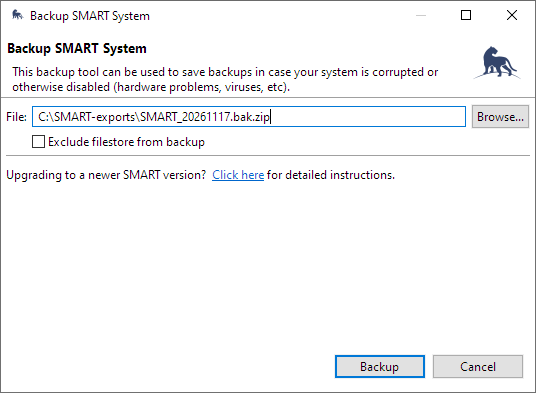

4. Subiri ujumbe **Uchelezi umekamilika** (Backup Complete), unaotaja faili, kisha chagua **OK**.

    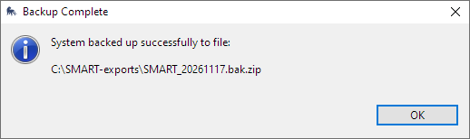

5. Tafuta faili kwenye folda uliyochagua. Inaitwa `SMART_<date>.bak.zip`, tarehe ikiwa mwaka, mwezi na siku.

    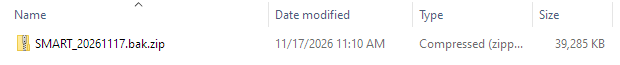

Chelezo yenye picha inaweza kuwa kubwa, kwa sababu ina picha za kila eneo la hifadhi.

### Folda ya SMART iliyobanwa {: .tab }

**SMART Desktop lazima iwe imefungwa kabla ya kubana folda yake.** SMART ikiwa wazi bado inaandika kwenye hifadhidata yake, na zip iliyotengenezwa wakati huo inaweza kuwa na hifadhidata isiyoweza kusomwa.
{: .important }

1. Funga SMART Desktop: chagua **Faili → Ondoka** (File → Exit), kisha subiri dirisha lake litoweke.
2. Kwenye File Explorer, tafuta folda ambayo SMART Desktop inaendeshwa kutoka kwake. Ni folda yenye `SMART.exe` na folda iitwayo `data`. SMART haina mahali maalum kwenye diski: inaendeshwa kutoka pale folda yake ilipowekwa wakati wa kusakinishwa.

    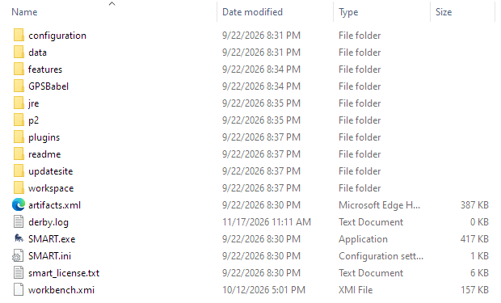

3. Panda ngazi moja juu, bofya folda hiyo kwa kitufe cha kulia cha kipanya, kisha chagua **Send to → Compressed (zipped) folder**. Kwenye Windows 11, chagua **Compress to ZIP file**.

    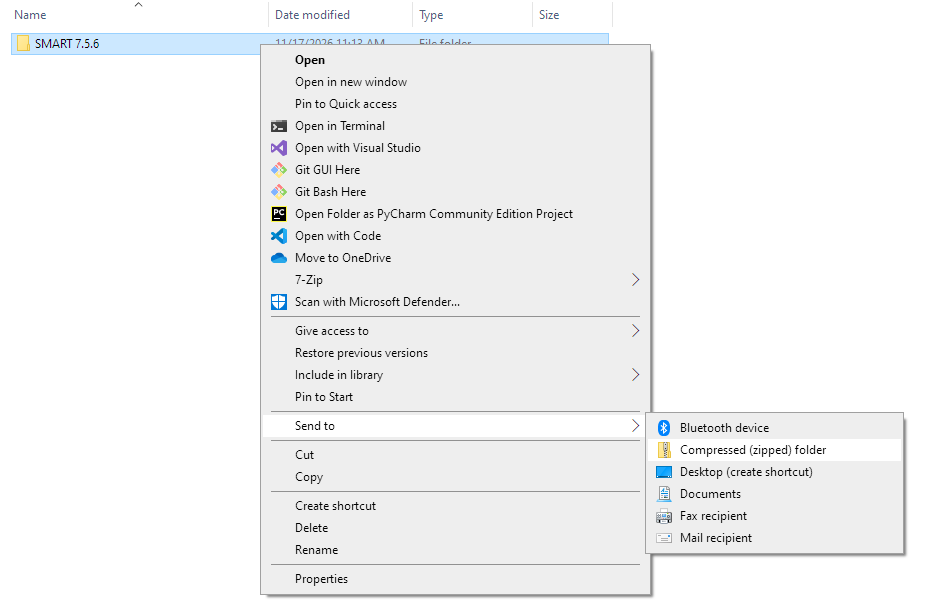

4. Windows inaandika faili ya `.zip` kando ya folda. Hii inaweza kuchukua dakika kadhaa na gigabaiti kadhaa za nafasi tupu kwenye diski. Acha SMART Desktop ikiwa imefungwa hadi imalizike.

## Kutoka EarthRanger: tovuti na tokeni

Programu inaandika kwenye EarthRanger kama mtumiaji mmoja wa EarthRanger, kupitia tokeni ya API ya mtumiaji huyo. Unahitaji:

- **Anwani ya seva (host) ya tovuti**, kwa mfano `example.pamdas.org`. Andika anwani ya seva pekee, bila `https://` wala njia.
- **Tokeni ya API** ya mtumiaji wa tovuti hiyo. Mwombe msimamizi wa EarthRanger wa tovuti akupe.

Mtumiaji mwenye tokeni lazima aweze kusimamia aina za doria, wahusika, makundi ya wahusika, usanidi wa doria na sehemu za kujaza za doria, na kuunda matukio. Mtumiaji mkuu (superuser) ndilo chaguo rahisi. Kwa mtumiaji mwenye ruhusa chache zaidi, uingizaji unakuambia kila ruhusa inayokosekana.

Programu inahakiki tokeni kwenye tovuti kabla ya kuihifadhi, na baadaye inaonyesha herufi zake za mwisho tu. [Tovuti na tokeni](../../help/sw/02-sites.md) inaeleza tokeni inahifadhiwa wapi na nani anaweza kuitumia.

Ni vyema kuingiza kwanza kwenye tovuti ya majaribio, kama mteja anayo.

## Kinachofuata

Ukiwa na faili na tokeni mkononi: [Uhamishaji wako wa kwanza](03-your-first-migration.md).
